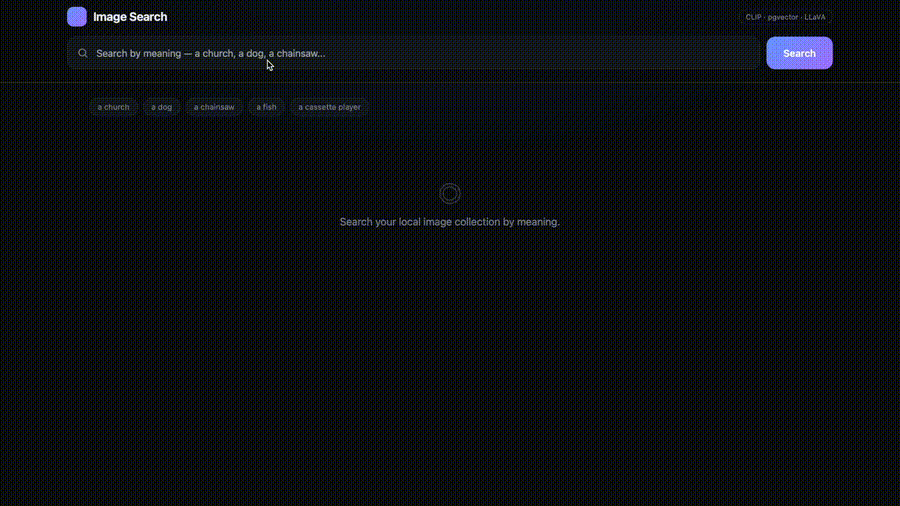

# Image Search

Semantic image search that runs entirely on your own machine. Search a local
image collection **by meaning** (type "a church", get churches) and click any
result to have a local vision-language model describe it — no external APIs, no
cloud inference.



## What it does

- **Text-to-image search** — a text query and the images live in the same CLIP
  embedding space, so results are ranked by semantic similarity rather than
  filenames or tags.
- **On-demand captioning** — clicking a result runs a local VLM (LLaVA) on that
  single image and caches the caption in Postgres, so repeat clicks are instant.
- **Fully local** — embeddings, vector search, and captioning all run on the
  local machine; nothing is sent to a third-party service.

## How it works

The system is built as four layers:

| Layer | Responsibility | Tech |
|-------|----------------|------|
| Ingestion | Walk an image folder, embed each image, store it | `open_clip`, PyTorch |
| Storage | Hold vectors + metadata together, indexed for fast search | PostgreSQL + pgvector (HNSW) |
| Retrieval | Embed the query, find nearest neighbours | pgvector cosine (`<=>`) |
| Serving | Search API + web UI + on-demand VLM captioning | FastAPI, LLaVA via Ollama |

Images and text are both encoded with **CLIP (ViT-B-32)** into 512-dimensional
vectors. Those vectors are stored in a pgvector column with an **HNSW index** for
approximate nearest-neighbour search. A query is embedded the same way and matched
against the stored vectors by cosine distance. Captions are generated only when a
user clicks an image, keeping ingestion fast.

## Stack

- **Embeddings:** CLIP (ViT-B-32) via `open-clip-torch`
- **Vector store:** PostgreSQL 17 + pgvector (HNSW, cosine)
- **VLM:** LLaVA (7B) served locally through Ollama
- **API / UI:** FastAPI + a single-file frontend
- **Dataset:** [Imagenette](https://github.com/fastai/imagenette) (a 10-class
  subset of ImageNet)

## Setup

### Requirements

- Python 3.11+
- Docker (for PostgreSQL + pgvector)
- [Ollama](https://ollama.com) (for local VLM captioning)
- Apple Silicon Mac or an NVIDIA GPU recommended (CPU works, but slower)

### 1. Database

```bash
docker run -d --name imgsearch-db \
  -e POSTGRES_PASSWORD=devpass \
  -e POSTGRES_DB=imgsearch \
  -p 5432:5432 \
  pgvector/pgvector:pg17
```

Create the table:

```bash
docker exec -i imgsearch-db psql -U postgres -d imgsearch -c "DROP TABLE IF EXISTS images; CREATE TABLE images (id serial PRIMARY KEY, path text UNIQUE NOT NULL, category text, caption text, created_at timestamptz DEFAULT now(), embedding vector(512));"
```

### 2. Python environment

```bash
python3 -m venv .venv
source .venv/bin/activate
pip install open-clip-torch torchvision "psycopg[binary]" pgvector pillow fastapi "uvicorn[standard]" ollama
```

### 3. Dataset

```bash
curl -L -o imagenette.tgz https://s3.amazonaws.com/fast-ai-imageclas/imagenette2-160.tgz
mkdir -p data && tar -xzf imagenette.tgz -C data
```

### 4. Ingest images

```bash
python3 ingest.py
```

This embeds the images and writes them to Postgres. Then create the vector index:

```bash
docker exec -i imgsearch-db psql -U postgres -d imgsearch -c "CREATE INDEX ON images USING hnsw (embedding vector_cosine_ops);"
```

### 5. Local VLM

Make sure Ollama is running and the model is pulled:

```bash
ollama pull llava:7b
```

### 6. Run

```bash
python3 -m uvicorn app:app --reload
```

Open **http://127.0.0.1:8000**, search by meaning, and click any result to
describe it.

## Project structure

```
.
├── ingest.py     # ingestion pipeline: folder -> embeddings -> Postgres
├── search.py     # standalone search / ranking sanity check
├── app.py        # FastAPI server + web UI + on-demand captioning
├── data/         # Imagenette images (downloaded)
└── README.md
```

## Notes & limitations

- Search only returns images that exist in the collection — a semantic search
  always returns *something*, so out-of-domain queries return the least-bad match
  rather than "no result".
- Ingestion currently loads a subset of Imagenette (configurable in `ingest.py`
  via `CATEGORIES_LIMIT` / `PER_CATEGORY_LIMIT`).
- Captioning quality is bounded by the small LLaVA-7B model; it identifies main
  subjects reliably but can hallucinate background details.